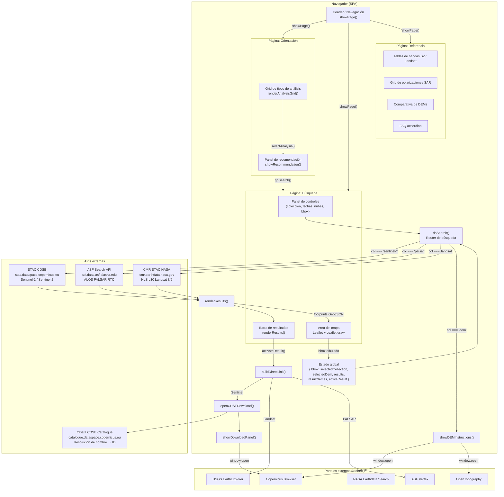
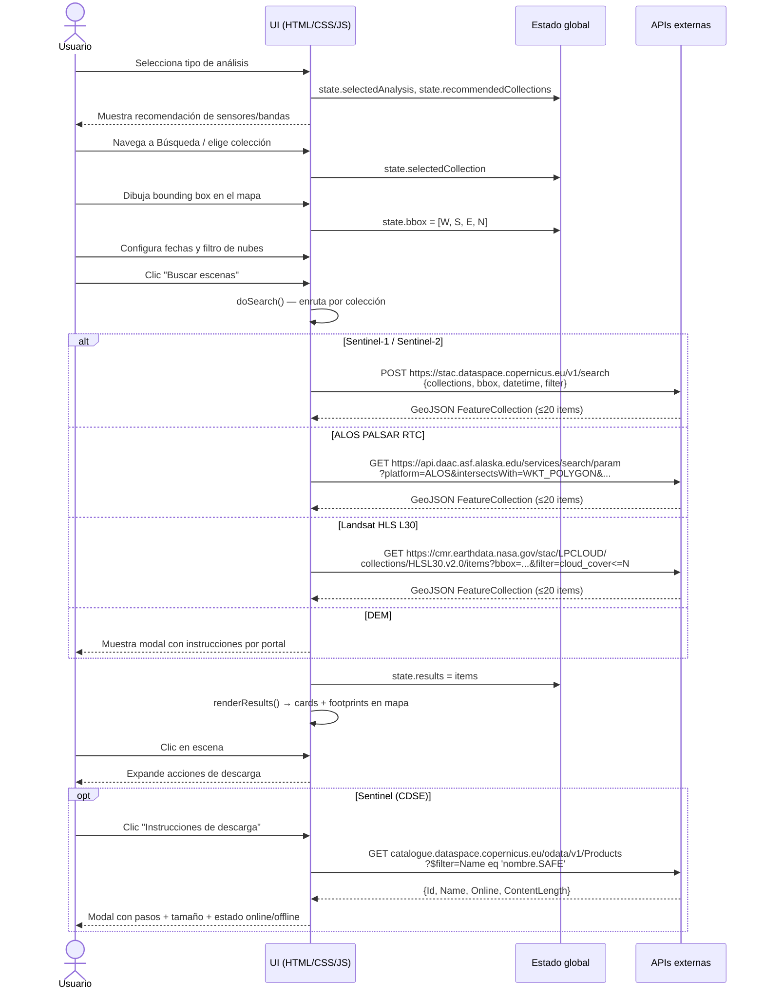

# Arquitectura del sistema

## Visión general

SatGuide es una SPA (Single-Page Application) sin backend. Toda la lógica reside en el cliente (navegador). No existe base de datos propia ni servidor de aplicaciones; el estado de la sesión vive en memoria JavaScript.

```
┌─────────────────────────────────────────────────────────────────┐
│                        NAVEGADOR (cliente)                       │
│                                                                  │
│   ┌──────────┐   ┌──────────────┐   ┌──────────────────────┐   │
│   │  Página  │   │   Página     │   │      Página          │   │
│   │Orientac. │   │  Búsqueda    │   │    Referencia        │   │
│   └────┬─────┘   └──────┬───────┘   └──────────────────────┘   │
│        │                │                                        │
│        │         ┌──────┴──────────────────────┐                │
│        │         │         Estado global        │                │
│        │         │  bbox, selectedCollection,   │                │
│        │         │  results, activeResult, ...  │                │
│        │         └──────┬──────────────────────-┘                │
│        │                │                                        │
│        │         ┌──────┴──────────────────────┐                │
│        │         │        doSearch()            │                │
│        │         │  Router de búsqueda por      │                │
│        │         │  colección seleccionada      │                │
│        │         └──┬───────┬──────────┬───────┘                │
│        │            │       │          │                         │
└────────┼────────────┼───────┼──────────┼─────────────────────── ┘
         │            │       │          │
         ▼            ▼       ▼          ▼
    [Leaflet +   [STAC CDSE] [ASF API] [CMR STAC]
     Draw]       Sentinel    PALSAR    Landsat
                 S1 / S2
```

---

## Diagrama de componentes (Mermaid)



---

## Diagrama de flujo de datos



---

## Patrones de diseño detectados

- **SPA sin router**: navegación entre páginas mediante clases CSS (`.page.active`) y la función `showPage()`. No hay hash routing ni History API.
- **Estado centralizado en objeto plano**: el objeto global `state` actúa como store mínimo (sin reactividad, sin framework).
- **Render functions**: las funciones `renderAnalysisGrid()`, `renderCollections()`, `renderResults()`, `renderReference()` generan HTML mediante template literals y `innerHTML`. No se usa virtual DOM.
- **Data constants**: todos los datos de referencia (bandas, polarizaciones, DEMs, FAQ) son arrays/objetos de constantes declarados antes de las funciones.
- **Fallback degradado**: cada búsqueda tiene manejo de error con `try/catch` que abre el portal externo correspondiente como alternativa cuando la API falla.
- **Copy-to-clipboard con fallback**: `copyProductName()` intenta `navigator.clipboard.writeText()` y cae a `document.execCommand('copy')` para compatibilidad.

---

## Tecnologías y versiones

| Capa | Tecnología |
|---|---|
| Lenguaje | HTML5, CSS3, JavaScript ES2017+ (vanilla, sin transpilación) |
| Mapa | Leaflet 1.9.4 |
| Dibujo espacial | Leaflet.draw 1.0.4 |
| Tipografías | Google Fonts (Syne, Outfit, JetBrains Mono, Instrument Sans) |
| Build system | **NO DETECTADO** (no hay bundler, no hay compilación) |
| Framework JS | **NO DETECTADO** (vanilla JS) |
| Framework CSS | **NO DETECTADO** (CSS custom properties propio) |
